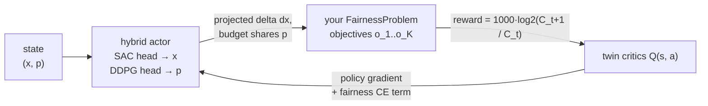

# maxmin-fairness-rl

**Deep reinforcement learning for max-min fairness over any constrained optimisation problem.**

[](https://ieeexplore.ieee.org/document/11803112)
[](https://ayush010104.github.io/sim-maxmin-fairness-drl/)


Max-min fairness does not maximise a total; it lifts the worst-off objective. This library packages the
agent behind that idea as a problem-agnostic core: you describe your problem in a few methods
(variables, constraints, objectives) and the agent learns to raise the minimum objective without
neglecting the rest. No domain model is included: the problem is yours to plug in.

It is the general-purpose core of the agent behind *Deep Reinforcement Learning Enabled Max-Min Fairness
in Stacked Intelligent Metasurfaces Assisted MISO Downlink* (Patel & Jindal, IEEE TMLCN). The paper's
stacked-metasurface system model and experiments are not part of this repository; see
[Relationship to the paper](#relationship-to-the-paper).

## How it works



* **Optimisation as an MDP.** The state is the current solution; the action is an *incremental update*
  to it; the environment applies the update, evaluates the objectives and returns the reward.
* **Composite log-ratio reward.** With objectives `o_1..o_K`, the quality of a solution is
  `C = gm_weight * GM(o) + min_weight * min(o)`, and the reward is `1000 * log2(C_{t+1} / C_t)`.
  The geometric mean keeps every objective in the learning signal, the minimum keeps pressure on the
  bottleneck, and the log-ratio rewards *relative* progress and is exactly zero when nothing changes.
* **In-graph projected-delta (IGPD) actions.** Variables with a hard constraint (for example unit-modulus
  phases) are updated by proposing a step, projecting `x + step` back onto the feasible set *inside the
  autograd graph*, and storing the **projected delta** as the action. Many raw proposals project to the
  same point; storing the delta means the critic always sees the action that actually caused the transition.
* **One hybrid actor.** A stochastic SAC head drives the incrementally-updated block `x` (exploration
  matters there); a deterministic DDPG head outputs a simplex block `p` of budget shares directly
  (stability matters there). Both feed one pair of critics over the joint action.
* **Fairness-aware cross-entropy regulariser.** The actor loss gets a term pulling `p` towards a target
  distribution proportional to the inverse objectives, so under-served objectives get a larger share.
  Its weight tracks the policy loss: `lambda = 0.1 * 10^floor(log10 |L_policy|)`.
* **SAC-Lite critics.** Entropy regularisation appears in the actor's policy-improvement loss only and is
  left out of the critics' Bellman target ([Yu et al., 2022](https://arxiv.org/abs/2201.12434)).
* **Finite replay.** A buffer much smaller than the training horizon discards stale, low-objective
  transitions automatically. Prioritised sampling can optionally be switched on late in training.

## Install

```bash
git clone https://github.com/Ayush010104/maxmin-fairness-rl
cd maxmin-fairness-rl
pip install -e ".[dev]"
pytest          # unit tests for the components and short training loops
```

Requires Python 3.9+, PyTorch 2.0+ and NumPy.

## Quickstart

Subclass `FairnessProblem`. The agent works with two blocks of variables: `x` (updated incrementally and
projected onto your constraint set) and `p` (shares of a budget, a point on the simplex). Use `n_p = 0` if
you have no budget block.

```python
import numpy as np
from maxmin_rl import FairnessProblem, train, unit_modulus


class MyProblem(FairnessProblem):
    n_objectives = 4
    n_x = 32          # e.g. 16 phases as interleaved [re, im] pairs
    n_p = 4           # budget shares; must equal n_objectives for the default CE target

    def initial_point(self, rng):
        theta = rng.uniform(0, 2 * np.pi, self.n_x // 2)
        x = np.empty(self.n_x); x[0::2], x[1::2] = np.cos(theta), np.sin(theta)
        return x, np.full(self.n_p, 1 / self.n_p)

    def objectives(self, x, p):
        ...  # return n_objectives strictly positive numbers

    def project_x(self, x):          # differentiable, (B, n_x) -> (B, n_x)
        return unit_modulus(x)


result = train(MyProblem(), steps=10_000, seed=0)
print(result.best_min, result.best_objectives, result.best_p)
```

`train` returns the **best solution seen at any step** (`best_x`, `best_p`, `best_objectives`) as well as
the per-step minimum objective (`min_history`). A complete runnable problem is in
[`examples/toy_phase_power.py`](examples/toy_phase_power.py):

```bash
python examples/toy_phase_power.py --steps 3000
```

### What you provide

| Method / attribute | Purpose |
| --- | --- |
| `n_objectives`, `n_x`, `n_p` | Sizes of the objective vector and the two variable blocks. |
| `initial_point(rng)` | A random feasible starting point `(x0, p0)`. |
| `objectives(x, p)` | The `n_objectives` strictly positive values to be made fair. |
| `project_x(x)` | Differentiable projection of `(B, n_x)` proposals onto the feasible set (default: identity). |
| `fairness_target(o)` | Target distribution for the CE term (default: inverse objectives; needs `n_p == n_objectives`; return `None` to disable). |

Built-in projections: `unit_modulus` (interleaved re/im pairs), `box(low, high)`, `identity`.
Objectives must be strictly positive; shift or rescale them if they are not.

## Configuration

`train(problem, steps, seed, config=AgentConfig(...), **env_kwargs)`

| `AgentConfig` | Default | Meaning |
| --- | --- | --- |
| `gamma` / `tau` | 0.7 / 1e-4 | Discount factor / Polyak coefficient. |
| `actor_lr` / `critic_lr` | 4e-4 / 1e-4 | Adam learning rates. |
| `batch_size` / `buffer_size` | 128 / 2750 | Mini-batch size / replay capacity (keep it below `steps`). |
| `actor_hidden` / `critic_hidden` | (200, 200) / (256, 256) | Hidden widths. |
| `max_step` | 0.45 | Largest per-step change of `x` (scales the `tanh` output). |
| `sigma_scale` | 0.2 | Scales the std-dev of the stochastic head. |
| `alpha`, `alpha_after`, `alpha_switch_step` | 0.27, 0.1, 8000 | Entropy temperature schedule (`None` = never switch). |
| `use_ce`, `ce_scale` | True, 0.1 | Cross-entropy regulariser and its relative weight. |
| `per_start_step`, `per_exponent` | None, 1.3 | Optional prioritised replay: from this env step on, sample with probability proportional to `priority ** per_exponent` (`None` = uniform sampling). |
| `actor_clip` / `critic_clip` | 4.0 / 2.0 | Gradient-norm clipping. |
| `device` | auto | `"cuda"` if available, else `"cpu"`. |

Environment keyword arguments: `gm_weight=0.4`, `min_weight=0.6`, `reward_scale=1000`,
`start_candidates=1` (draw several starting points and begin from the best).

The defaults are tuned for ~10k-step runs. For shorter runs, move `alpha_switch_step` earlier.

## Notes and limits

* The log-density used for the entropy term is that of the `tanh`-squashed Gaussian sample, with the
  change-of-variables correction for `tanh`. It is **not** corrected for `project_x`, which is treated as
  constraint enforcement rather than as part of the stochastic policy.
* The share head is `softmax(sigmoid(.))`. Since `sigmoid` lies in (0, 1), every share is confined to
  `[1/(1+(K-1)e), e/(e+K-1)]` (about 0.109 to 0.475 for K = 4): corner solutions of the simplex are not
  reachable. This follows the original design; if your optimum needs more extreme shares, replace the head.
* BatchNorm is used in the networks, so `batch_size` must be at least 2.
* Critics and target critics stay in training mode, so BatchNorm uses batch statistics when forming the
  Bellman target. The final step of a run is treated as terminal, although it is a time-limit truncation.
* Evaluation: `train` reports the best solution seen at any step, so compare methods on equal evaluation
  budgets and over several seeds.
* `n_x` must be positive. The incremental block is the primary variable; the simplex block is optional.

## Repository layout

```
src/maxmin_rl/
  problem.py      FairnessProblem interface (what you implement)
  env.py          MDP wrapper, reward, best-solution tracking
  rewards.py      composite metric, log-ratio reward, inverse-objective target
  projections.py  in-graph projections
  networks.py     hybrid actor, critic
  agent.py        hybrid SAC-DDPG agent, CE regulariser
  replay.py       finite replay buffer (optional prioritised sampling)
  trainer.py      training loop
examples/         a runnable synthetic problem (toy_phase_power.py)
tests/            unit tests of components and short training loops
```

## Relationship to the paper

* This repository is the **problem-agnostic core** of the method. The paper's SIM system model, channel
  generation, baselines and experiments are not included, and this repository does not reproduce the paper's
  numbers.
* Default hyperparameters come from the author's experiment code and may differ from the tables in the paper.
* The bundled example is a small synthetic problem for demonstration, not a result from the paper.

## Citation

If you use this code, please cite the paper (see also [`CITATION.cff`](CITATION.cff)):

```bibtex
@article{patel2026maxmin,
  title   = {Deep Reinforcement Learning Enabled Max-Min Fairness in Stacked Intelligent Metasurfaces Assisted MISO Downlink},
  author  = {Patel, Ayush Brijesh and Jindal, Abhishek},
  journal = {IEEE Transactions on Machine Learning in Communications and Networking},
  year    = {2026},
  url     = {https://ieeexplore.ieee.org/document/11803112}
}
```

## License

MIT. See [LICENSE](LICENSE).
